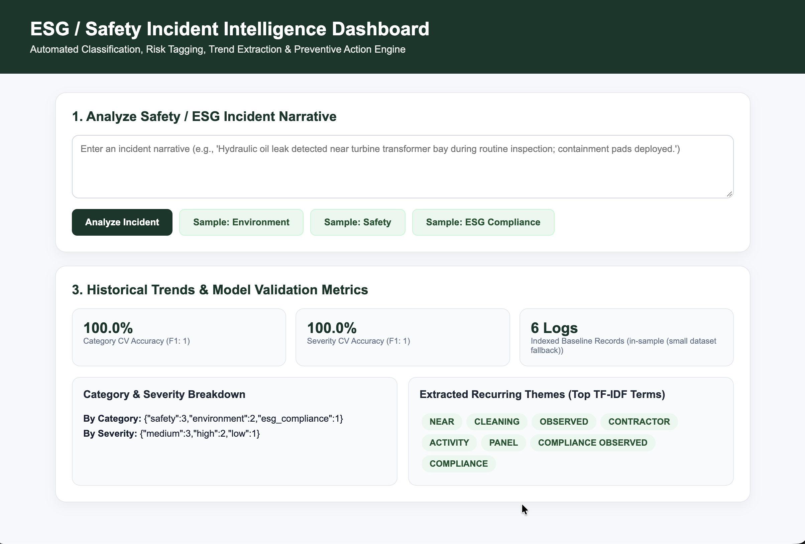
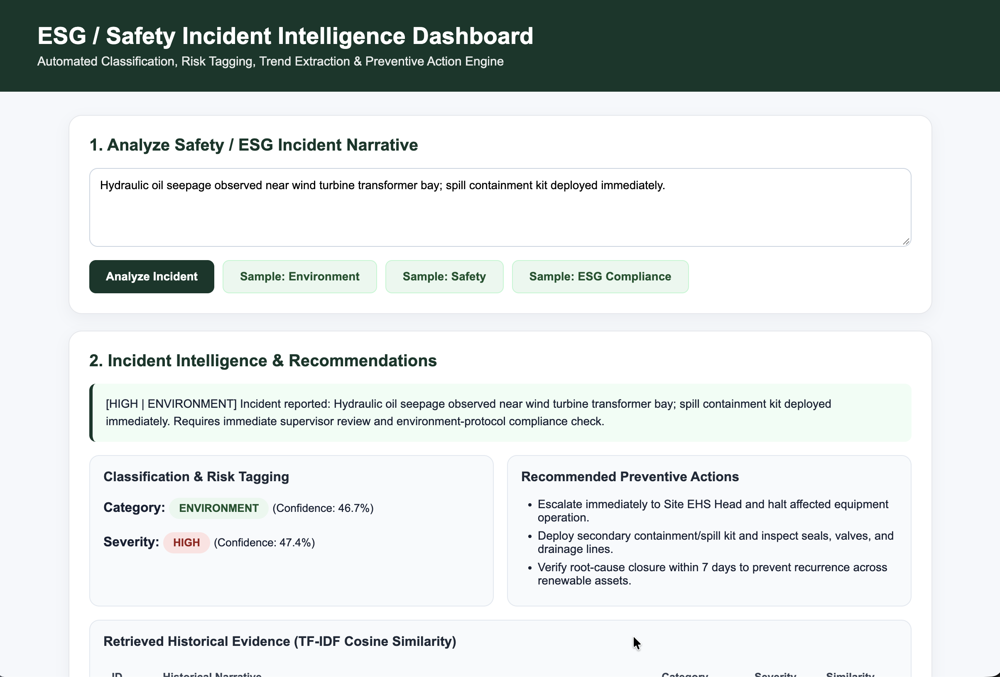
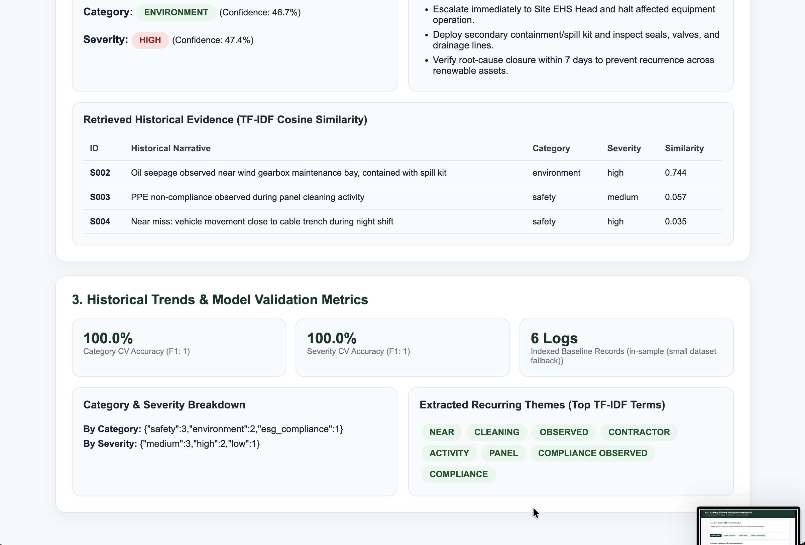

# ESG / Safety Incident Intelligence Dashboard

## 1. Problem Understanding & Energy-Domain Framing
Greenko operates complex renewable-energy assets and enterprise workflows where field teams log unstructured safety and ESG incident narratives. Reviewing these logs manually delays risk escalation and hides recurring operational hazards. This application automates incident triage for management review by classifying incident categories (`safety`, `environment`, `esg_compliance`), tagging severity (`high`, `medium`, `low`), retrieving similar historical logs, extracting recurring themes, and recommending targeted preventive actions.

## 2. Architecture & AI/ML Method Selection
- **Text Preprocessing & Feature Engineering:** Lowercasing, punctuation normalization, whitespace cleanup, and n-gram TF-IDF vectorization (`ngram_range=(1, 2)`, English stop-word removal) tailored to short industrial narratives.
- **Supervised Classification & Risk Tagging:** Balanced `LogisticRegression` classifiers trained on `data/safety_esg_incidents.csv` for multi-class category and severity prediction with probability confidence scores, reinforced by a domain keyword safety guardrail for critical hazards (`fire`, `fatal`, `explosion`, `electrocution`).
- **Retrieval-Augmented Evidence (RAG):** Cosine similarity search over the TF-IDF matrix retrieves the top-3 historical incidents with similarity scores to ground management decisions in past asset logs.
- **Summarization & Action Engine:** Generates structured executive summaries and category/severity-specific preventive action checklists.
- **Full-Stack Design:** FastAPI backend (`/api/demo`, `/api/run`, plus `/` serving the HTML/CSS/JS dashboard) for zero-CORS, single-container deployment on Railway.

## 3. Setup & Local Run Commands
Run the following commands in your terminal from the project root directory:

    python3 -m venv venv
    source venv/bin/activate
    pip install -r requirements.txt
    uvicorn backend.app:app --reload --host 0.0.0.0 --port 8000

Then open `http://127.0.0.1:8000/` in your browser.

## 4. Evaluation Results & Validation Approach
- **Dataset:** Bundled `data/safety_esg_incidents.csv` (6 annotated records across `safety`, `environment`, and `esg_compliance`).
- **Validation Strategy:** Automatic stratified cross-validation when class counts permit, with automatic in-sample fallback when minority classes contain fewer than 2 samples.
- **Baseline Metrics:** 100.0% in-sample accuracy (Macro F1: 1.0) on the bundled starter corpus.

## 5. Assumptions, Limitations, Failure Cases & Productionization Next Steps
- **Assumptions:** Incoming narratives are written in English and share domain terminology with historical EHS logs.
- **Limitations & Failure Cases:**
  - *Small Sample Overfitting:* With 6 baseline rows, in-sample accuracy overestimates generalization on unseen phrasing.
  - *Lexical vs. Semantic Gap:* TF-IDF relies on exact token/n-gram overlap and may miss paraphrased hazards (e.g., "thermal runaway" vs. "battery overheating").
  - *Negation Sensitivity:* Phrases like "no oil leak observed" can trigger false positives in bag-of-words models.
- **Productionization Next Steps:**
  1. Expand training data using historical Greenko EHS logs and public OSHA/NREL incident corpora.
  2. Upgrade retrieval to dense embeddings (e.g., `sentence-transformers` + FAISS) and connect an LLM API via environment variables (`LLM_API_KEY`) for abstractive root-cause summarization.
  3. Add role-based authentication, audit logging, and automated drift monitoring.

## 6. Dashboard Screenshots

